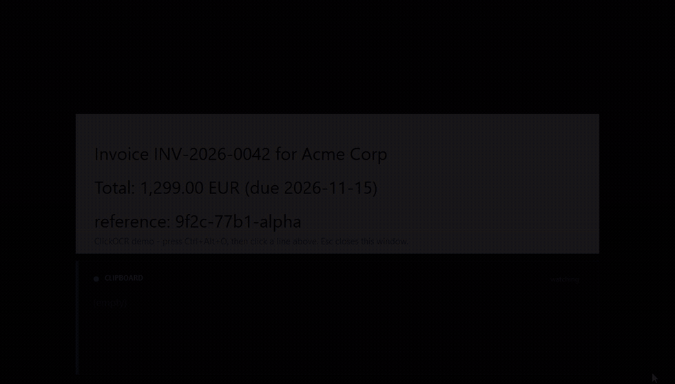

# ClickOCR

Point at a word on screen, press a hotkey, click — the text lands on your clipboard.

Windows has a very good OCR engine (`Windows.Media.Ocr`) built in. ClickOCR is a thin
tray app around it that answers "what does *this* word say?" instead of "OCR this box":

```
Ctrl+Alt+O   ->  screen freezes and dims  ->  click the word  ->  clipboard
```



*Recorded with `--demo`: the first click copies the whole line, `Ctrl`+click copies one
word; the panel under the sample text is the live clipboard. [Bigger MP4](docs/demo.mp4).*

- Runs offline, no cloud, no account, no install, no admin rights.
- ~57 KB single .exe, .NET Framework 4.8 + the OCR engine that ships with Windows.
- Works on any visible text: browsers, PDFs, screenshots, images, games, videos, error dialogs.
- Knows *where* the word is, because it uses the OCR word bounding boxes to decide what you clicked.

## Quick start

```powershell
cd ClickOCR
powershell -ExecutionPolicy Bypass -File .\build.ps1      # builds bin\ClickOCR.exe
.\bin\ClickOCR.exe                                        # tray icon appears
```

Then press **Ctrl+Alt+O**, click some text, paste.

No build toolchain? Take `ClickOCR.exe` from the [latest release](../../releases/latest).

Want to see it work first?

```powershell
.\bin\ClickOCR.exe --demo
```

A sample window opens: a fake invoice plus a live clipboard panel, so every click shows its
result without pasting anywhere. It also writes the on-screen coordinates of a few words to
`%APPDATA%\ClickOCR\demo-anchors.txt`, which is what `tests\e2e.ps1` clicks.

## Using it

| Action | Result |
| --- | --- |
| `Ctrl+Alt+O`, then click | the whole line / string under the pointer |
| `Ctrl+Alt+O`, then `Ctrl`+click | just the word under the pointer |
| `Ctrl+Alt+O`, then `Shift`+click | every line in the captured area |
| `Esc` or right-click | cancel the picker |
| Double-click the tray icon | same as the hotkey |

After a grab a small bubble shows what was copied; it never steals focus, so you can
keep typing in the app you came from.

The picker freezes the screen first, so nothing redraws or scrolls while you aim.
It also cancels itself after 45 seconds so it can never leave your desktop dimmed.

### Tray menu

- **Grab text** — same as the hotkey.
- **Settings...** — opens `%APPDATA%\ClickOCR\config.ini` in Notepad.
- **Start with Windows** — writes the usual `HKCU\...\Run` entry (with `--silent`).
- **Run self-test...** — checks OCR, capture, hit-testing and clipboard; opens a report.
- **Open log** — `%APPDATA%\ClickOCR\log.txt`, every grab with timings and result.
- **Help / About**, **Exit**.

## Settings — `%APPDATA%\ClickOCR\config.ini`

Created with defaults on first run; restart the app after editing.

```ini
Hotkey=Ctrl+Alt+O       ; global shortcut
RegionWidth=1400        ; how much of the screen around the click is OCR'd (pixels)
RegionHeight=320
ClickAnchor=0.34        ; where the click sits inside that region (0 = left edge, 1 = right)
Dim=0.35                ; dimming of the frozen screen, 0 - 0.85
Language=               ; e.g. en-US, de-DE, zh-Hans-CN; empty = Windows display language
ClicklessGrab=0         ; 1 = skip the picker, OCR straight under the pointer
```

`ClicklessGrab=1` is the "point and shoot" variant: put the pointer on a word, press the
hotkey, done — no second click. (Line mode only.)

`ClickAnchor` matters more than it looks: text normally continues to the *right* of the
pointer, so the default puts the click at ~1/3 of the captured width. Raise it if you
often miss the left part of long lines.

**Languages:** only the OCR packs installed in Windows are available. See them in
*Settings > Time & Language > Language* (the "Optical character recognition" optional
feature) or in the self-test report. The current engine language is shown in *Help / About*.

## Scripting / automation

The tray app also listens on a local named pipe (`ClickOCR.Control`), which is handy for
AutoHotkey, Stream Decks, CI or a keyboard macro:

```powershell
.\bin\ClickOCR.exe --send status                  # OK idle|picking hotkey=...
.\bin\ClickOCR.exe --send grab                    # freeze screen + show picker
.\bin\ClickOCR.exe --send pick 812 540 word       # supply click point + mode
.\bin\ClickOCR.exe --send grabcursor              # grab under the pointer (clickless)
.\bin\ClickOCR.exe --send quit
```

The last response is also written to `%APPDATA%\ClickOCR\control-last.txt`.

## Tests

```powershell
.\bin\ClickOCR.exe --selftest        # headless: OCR, screen capture, hit test, clipboard
powershell -File .\tests\e2e.ps1     # drives the real picker and checks the clipboard
powershell -File .\tests\clickless.ps1  # pointer + grabcursor, no click
```

`tests\e2e.ps1` needs an **idle desktop**: it opens the demo window, drives the app through
the control pipe, posts a real `WM_LBUTTONDOWN` to the picker and verifies the clipboard
for line/word/block modes. Don't touch the mouse while it runs.

## How it works

1. On the hotkey, the whole virtual screen is captured with `CopyFromScreen` (before
   anything is drawn), so the picker shows a frozen frame and needs no "wait for redraw".
2. The click point is mapped to a region around it (`RegionWidth` x `RegionHeight`,
   biased by `ClickAnchor`); only that region is sent to OCR — fast and accurate.
3. The bitmap is converted to a `SoftwareBitmap` (BGRA8) and passed to
   `OcrEngine.RecognizeAsync`. This returns lines and words, each with a bounding box.
4. The word whose box contains the click (or the nearest one within ~1.2 text heights)
   decides the result: the word, its whole OCR line, or every line in the region.
5. The text is written to the clipboard with retries (the clipboard is a shared resource
   and is occasionally locked for a few milliseconds).

The process is per-monitor DPI aware, so coordinates, OCR boxes and the capture all live
in physical pixels — correct on mixed-DPI multi-monitor setups.

## Limitations

- **Protected content is not capturable.** DRM video, some banking apps, and windows with
  `SetWindowDisplayAffinity(WDA_EXCLUDEFROMCAPTURE)` come back black — no OCR possible.
  Same for the Windows lock screen / secure desktop.
- OCR is not pixel-perfect: `9f2c-77b1-alpha` may come back as `9f2c-77b1 -alpha`, `l` vs
  `1`, `0` vs `O`, etc. Very small text (below ~10 px) or heavy stylised fonts degrade.
- Line mode returns the OCR line as the engine grouped it. In dense tables that can be a
  whole row; use `Ctrl`+click for a single cell/word.
- The exe is unsigned, so SmartScreen or your AV may ask once. It builds locally from the
  source in this folder and makes no network calls.
- Hotkey registration can fail if another app owns the combination; ClickOCR then tries
  `Ctrl+Shift+O`, `Ctrl+Alt+F9`, `Ctrl+Alt+Shift+O` and tells you in a balloon.

## Alternatives you can use today

If you would rather not run a custom build, these are all solid and free — but they are
*region* selectors, not *click-a-word* selectors:

| Tool | Shortcut | Notes |
| --- | --- | --- |
| **PowerToys Text Extractor** | `Win`+`Shift`+`T` | Microsoft's own; uses the same `Windows.Media.Ocr` engine; drag a box, text goes to the clipboard. Closest thing to "built in". |
| **Snipping Tool** | `Win`+`Shift`+`S` then *Text actions* | Ships with Windows 11 (and recent Windows 10); rectangle snip then "Copy all text". |
| **Text-Grab** (open source) | configurable | Fullscreen grab with word/line/paragraph modes, very close in spirit to ClickOCR; .NET, MIT. |
| **Capture2Text** | `Win`+`Q` | Region capture, many engines/languages, portable. |
| **PowerToys "Text Extractor" + OCR language packs** | — | Same engine, so the same accuracy you get here. |

The practical difference: with those you aim a rectangle (or a full screen) and get all the
text in it, then trim it in an editor. ClickOCR turns the pointer itself into the selector,
so the round trip is *click → paste* with no cropping step.

## Layout

```
ClickOCR/
  build.ps1              builds bin\ClickOCR.exe (uses the in-box C# compiler + WinMD)
  bin\ClickOCR.exe       the app
  src/                   C# sources (C# 5, .NET Framework 4.8, WinForms + Windows.Media.Ocr)
  tests/e2e.ps1          end-to-end test against the real picker
  docs/demo.gif          the recording above (docs/demo.mp4 = same thing, H.264)
```

## License

MIT — see [LICENSE](LICENSE). Do whatever you like with it, no attribution needed
beyond keeping the copyright notice.
